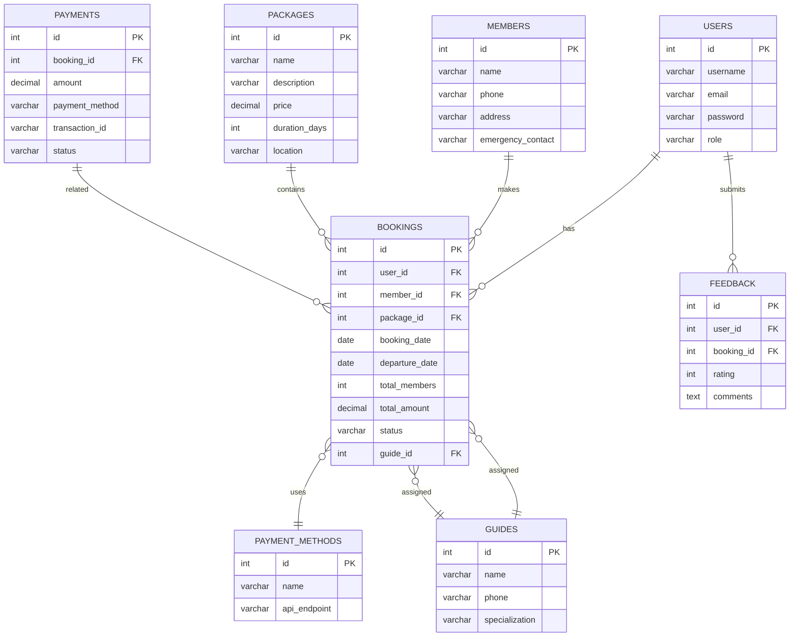

# Trekking Management Application

> **Status**: In Development (v2.0.0 - Vue + Flask Rewrite)

This is a complete rewrite of the trekking management system, migrating from the legacy Java/Swing architecture to a modern web-based application using **Vue.js** (Frontend) and **Flask** (Backend).

---

## 🚀 Quick Start

### Prerequisites

Ensure you have the following installed:

- **Python 3.8+**
- **Node.js 16+** and **NPM**
- **Vue CLI 5**

### Installation

1. **Backend Setup**
   ```bash
   cd backend
   pip install -r requirements.txt
   flask run
   ```

2. **Frontend Setup**
   ```bash
   cd frontend
   npm install
   npm run serve
   ```

3. **Access Application**
   - **Vue Dev Server**: [http://localhost:8080](http://localhost:8080)
   - **Flask API**: [http://localhost:5000](http://localhost:5000)

---

## 🛠️ Tech Stack

### Frontend
- **Framework**: [Vue.js](https://vuejs.org/) (v2)
- **Router**: [Vue Router](https://router.vuejs.org/)
- **State Management**: [Vuex](https://vuex.vuejs.org/)
- **HTTP Client**: [Axios](https://axios-http.com/)
- **UI Components**: [Element UI](https://element.eleme.io/)

### Backend
- **Framework**: [Flask](https://flask.palletsprojects.com/)
- **Database**: [MySQL](https://www.mysql.com/)
- **ORM**: [SQLAlchemy](https://www.sqlalchemy.org/)
- **Authentication**: [Flask-JWT-Extended](https://flask-jwt-extended.readthedocs.io/)
- **Validation**: [Flask-Marshmallow](https://marshmallow.readthedocs.io/)
- **CORS**: [Flask-CORS](https://flask-cors.readthedocs.io/)

---

## 📂 Project Structure

```
trekking_app/
├── frontend/         # Vue.js Client
│   ├── src/
│   │   ├── api/        # API Service (Axios)
│   │   ├── components/ # Vue Components
│   │   │   ├── admin/  # Admin Modules
│   │   │   ├── booking/ # Booking Modules
│   │   │   └── common/ # Shared Components
│   │   ├── router/     # Vue Router Configuration
│   │   ├── store/      # Vuex Store
│   │   └── views/      # Page Components
│   ├── public/       # Static Assets
│   └── package.json  # Dependencies
│
├── backend/          # Flask API Server
│   ├── models/       # SQLAlchemy Database Models
│   ├── routes/       # API Route Endpoints
│   │   ├── auth.py
│   │   ├── booking.py
│   │   ├── feedback.py
│   │   ├── guide.py
│   │   ├── members.py
│   │   ├── package.py
│   │   ├── payment.py
│   │   └── user.py
│   ├── schemas/      # Marshmallow Schemas (Serialization)
│   ├── app.py        # Flask Application Entry Point
│   └── requirements.txt
│
└── sql/              # Database Scripts
    └── trekking_db.sql
```

---

## 🔌 API Routes

### 🔐 Authentication
- `POST /api/auth/login` - User Login
- `POST /api/auth/register` - User Registration
- `GET /api/auth/me` - Get Current User

### 📝 Members
- `GET /api/members` - List Members
- `GET /api/members/:id` - Get Member Details
- `POST /api/members` - Create Member
- `PUT /api/members/:id` - Update Member
- `DELETE /api/members/:id` - Delete Member

### 📦 Packages
- `GET /api/packages` - List Packages
- `GET /api/packages/:id` - Get Package Details
- `POST /api/packages` - Create Package
- `PUT /api/packages/:id` - Update Package
- `DELETE /api/packages/:id` - Delete Package

### 💼 Bookings
- `GET /api/bookings` - List Bookings
- `GET /api/bookings/:id` - Get Booking Details
- `POST /api/bookings` - Create Booking
- `PUT /api/bookings/:id` - Update Booking
- `DELETE /api/bookings/:id` - Delete Booking

### 💰 Payments
- `POST /api/payments/initiate` - Initiate Payment
- `GET /api/payments/status/:order_id` - Check Payment Status

### 👥 Guides
- `GET /api/guides` - List Guides
- `POST /api/guides` - Add Guide

### 💬 Feedback
- `GET /api/feedback` - List Feedback
- `POST /api/feedback` - Submit Feedback

---

## 🏗️ Database Schema

### ER Diagram


---

## 🔄 Data Flow

1. **Authentication**: User logs in via Vue Frontend → Axios sends request to Flask API → Flask validates credentials → Returns JWT Token.
2. **Booking**: User selects package on Vue Frontend → Axios sends POST request → Flask creates booking in MySQL database.
3. **Payment**: User initiates payment → Flask interacts with payment gateway API → Updates booking status in database.

---

## 📈 System Metrics

### Performance
- **API Response Time**: ~100-500ms (avg)
- **Database Queries**: Optimized with indexing
- **Frontend Load Time**: ~1-2s

### Scalability
- **Microservices Ready**: Backend can be split into microservices
- **Horizontal Scaling**: Can run multiple Flask instances behind a load balancer
- **Stateless API**: JWT tokens enable horizontal scaling

---

## 📝 Future Enhancements

### Short-term
- [ ] Email notifications
- [ ] Payment gateway integration (Razorpay/Stripe)
- [ ]